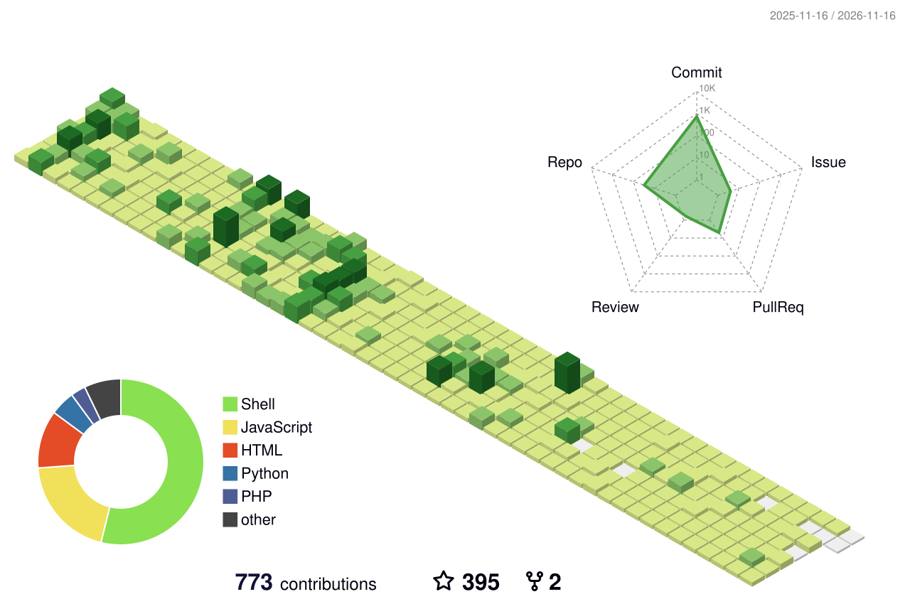
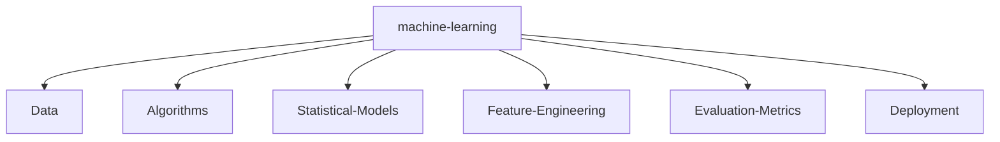

# ⭐ **Senior Developer** ⭐

## Contact me

<!--  -->

 
 

<!--   stats + languages -->
## GitHub Stats and Languages

<!--  
  -->
<!-- 
GitHub Stats and Languages
 -->
<!-- 
 -->

| GitHub Stats                                                                                                                                                 | Languages                                                                                                                              |
| ------------------------------------------------------------------------------------------------------------------------------------------------- | ------------------------------------------------------------------------------------------------------------------------------ |
|  |  |

 
 

## Trophy: Github Profile Trophy

<!-- 
 -->
<!-- 
Trophy: Github Profile Trophy
 -->
<!-- 
 -->

 

 
 

## Profile Views

 
 

## AI Skills
LangChain(LangGraph, LangSmith)/HuggingFace/RunPod/Ollama, MCP, LLM(Sonnet/Anthropic, GPT/OpenAI), Computer Vision, RAG, GenAI, Kaggle, Zapier/N8N automation, AI agent specialist, MCP(Model Context Protocol)

 
 

## Recommended By:

Many thanks from people that referenced this repository here.

 
 

## 🥇 Primary technology stack

 
 

## 🥈 Secondary technology stack

 
 

## 📈 GitHub Activity Graph:

<!--   green snake -->

<!--   profile-green-animate -->

   <!--machine-learning-->

